<h1 align="center">Hi, I'm Huy Dao 👋</h1>
<h3 align="center">Data Science grad student at Penn · UC Berkeley Data Science alum</h3>

  
  
  

<h3><code>huy@github ~ $ whoami</code></h3>
<table>
<tr>
<td valign="top"></td>
<td valign="top"></td>
</tr>
</table>

 

<h3><code>huy@github ~ $ ./contributions.sh</code></h3>

---

### About me
- 🎓 **MSE in Data Science, University of Pennsylvania** (expected May 2028)
- 🐻 **BA in Data Science, UC Berkeley** (2025), Applied Mathematics and Modeling emphasis
- 💼 Former **Data Science Intern at Oakland Natives Give Back**: cleaned attendance, GPA and discipline records for 18,000+ students, built chronic-absenteeism risk tiers, and turned interviews into recommendations for school leadership
- 🔭 Looking for **Data Scientist, Data Analyst and BI** roles: a Summer 2027 internship, then full time. Remote, Bay Area or Sacramento
- 🌱 I like turning messy real-world data into clear answers: SQL pipelines, statistical models and honest evaluation

### Tools I use

**Languages** 

**Analysis and machine learning** 

**Databases and big data** 

**Developer tools** 

<!-- TODAY:START -->
### Today on GitHub · Thu, Oct 29

- 🌱 Nothing public yet today — new commits are on the way.

Auto-refreshed every 24 hours from my public GitHub activity.
<!-- TODAY:END -->

### Coming soon
New projects and course write-ups go up through December:
- 🌫️ **Air Quality and Economic Mobility in California**: causal inference with propensity scores
- 🎮 **Pokémon GO IV Rank Checker**: a JavaScript web app that ranks all 4,096 IV combinations across leagues
- 📊 Write-ups on SQL and data engineering, big data with Spark, deep learning, optimization, statistics and machine learning

---

<i>Thanks for stopping by. The best way to reach me is <a href="https://www.linkedin.com/in/huy-dao-250736295">LinkedIn</a>.</i>

